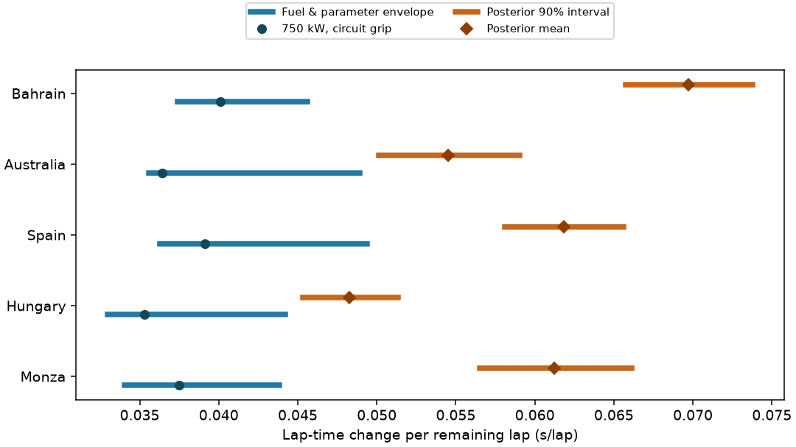
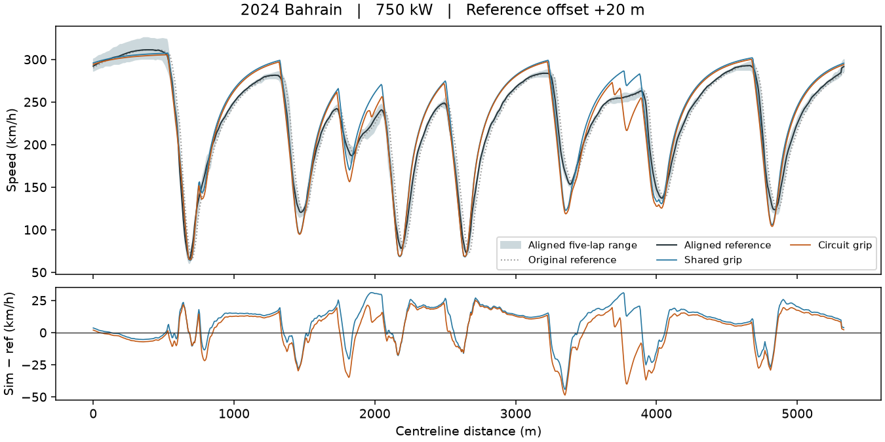
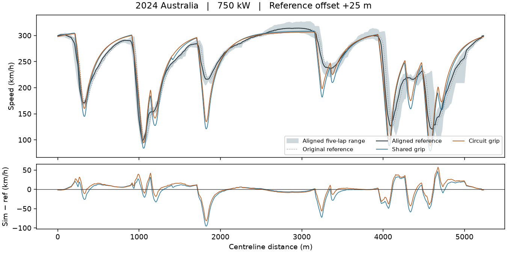
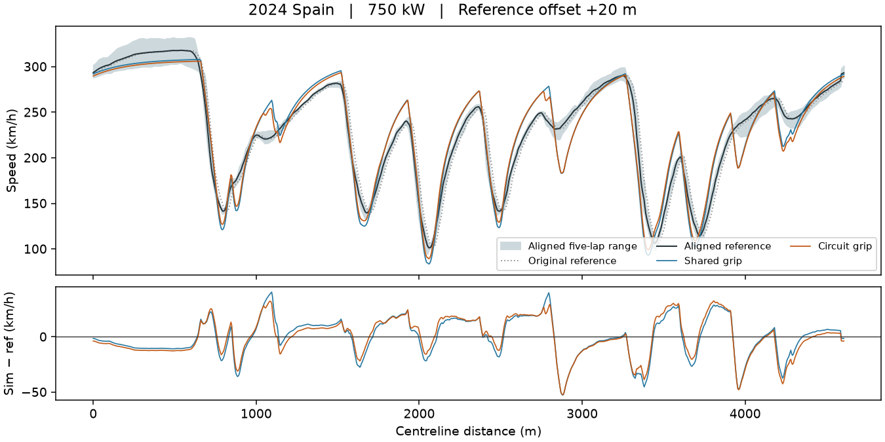
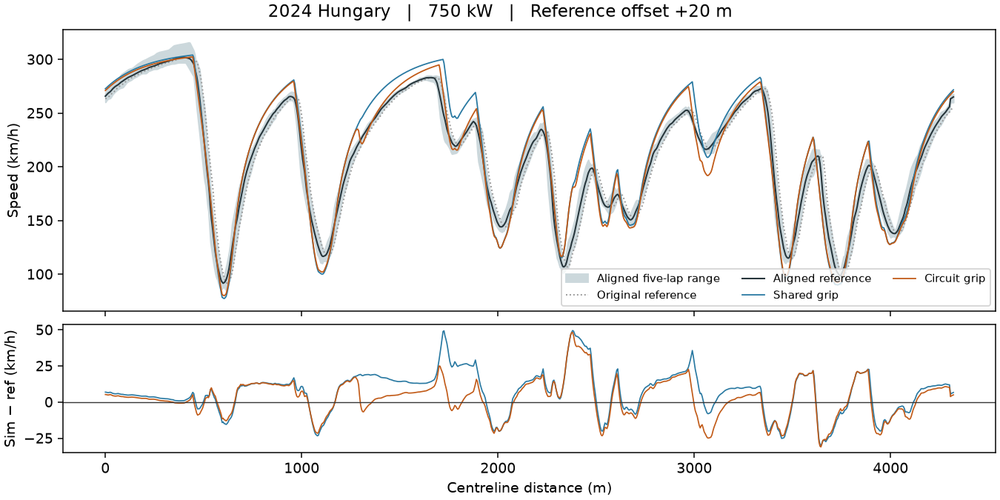
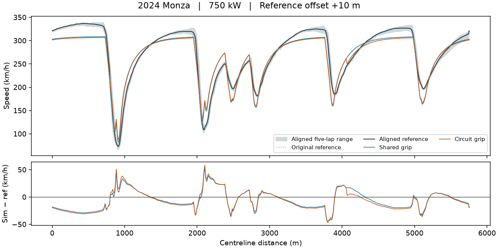

# T052｜五站速度对齐、固定功率标定及燃油对照

主方案取预设功率中档 750 kW、逐站 μ，以反映路面与轮胎差异；共用 μ 及 700/800 kW 均作敏感性检查。主方案选择不使用后验 γ。全部比较在同一批五个快圈上，属样本内结果。

## 1　参考曲线的距离偏移

固定 T050 共用参数模拟曲线，对每站原参考均速在 ±60 m 内按 5 m 周期平移，取未加权全圈 RMSE 最小的 δ。等价于最大化循环互相关：平移后曲线的均值、方差不变。正号取 ref(s+δ)，将参考特征向较小弧长移动；没有移动曲率、模拟轨迹或实测圈时。各次拟合沿用同一 δ，参考带和精度权重一同平移。

| 站 | δ m | v1 原 RMSE | v1 对齐 RMSE | δ/均速 s | 主方案原 RMSE | 主方案对齐 RMSE |
| --- | --- | --- | --- | --- | --- | --- |
| 巴林 | +20 | 17.85 | 10.96 | 0.35 | 24.87 | 15.04 |
| 澳大利亚 | +25 | 23.04 | 19.48 | 0.38 | 24.62 | 18.35 |
| 西班牙 | +20 | 19.11 | 15.26 | 0.34 | 22.98 | 17.08 |
| 匈牙利 | +20 | 18.12 | 12.79 | 0.37 | 22.53 | 13.35 |
| 蒙扎 | +10 | 13.71 | 12.50 | 0.14 | 21.38 | 18.96 |

五站方向一致，量级 10–25 m；换算时间仅按圈长/参考圈时作数量级诊断。常数距离不能表示全圈恒定时延，弯道曲率平滑、弧长映射、车手制动点和模型误差也可能造成偏移。建议 T048 维护者在原时间戳上先独立检验，再决定是否更改映射。

## 2　固定功率与拟合误差

三档都是有效轮上功率假设。两种模型分别拟合跨站共用的 CdA、ClA、机械制动上限；μ 共用或每站一项。T050 的各站固定质量（798 kg + 按五圈圈次估计的均余油）、5 m 闭环积分和损失权重不变：每站 J = 速度残差/10 km/h 的加权均方 + 圈时残差/2 s 的平方；点权重 ∝ 1/[100+((max−min)/2)²]，站内和为 1。主拟合上下界 CdA 0.5–3 m²（放宽 v1 的 2，以观察边界外趋势）、ClA 1–9 m²、制动 10–65 m/s²、μ 0.8–2.8。每组两个起点取低损失。

μ 顺序为巴林、澳大利亚、西班牙、匈牙利、蒙扎。下表四项误差为五站等权均值；极值误差取绝对值，速度单位 km/h。逐站有符号误差在 metrics.csv。

| kW | 抓地 | CdA | ClA | μ | 制动 m/s² | P/CdA | J | 圈时 MAE s | 速度 RMSE | 最高速 MAE | 最低速 MAE |
| --- | --- | --- | --- | --- | --- | --- | --- | --- | --- | --- | --- |
| 700 | 共用 | 1.803 | 6.360 | 1.431 | 21.82 | 388.3 | 16.456 | 1.455 | 16.82 | 8.49 | 12.32 |
| 700 | 逐站 μ | 1.841 | 4.729 | 1.496 / 1.827 / 1.673 / 1.573 / 1.669 | 20.71 | 380.2 | 10.888 | 0.097 | 15.90 | 9.80 | 9.82 |
| 750 | 共用 | 1.980 | 6.416 | 1.417 | 21.52 | 378.8 | 17.764 | 1.495 | 17.50 | 10.04 | 12.53 |
| 750 | 逐站 μ | 2.017 | 4.602 | 1.501 / 1.831 / 1.683 / 1.581 / 1.684 | 20.14 | 371.9 | 11.963 | 0.100 | 16.56 | 11.19 | 9.86 |
| 800 | 共用 | 2.142 | 5.956 | 1.455 | 21.00 | 373.5 | 19.093 | 1.595 | 18.02 | 10.95 | 12.17 |
| 800 | 逐站 μ | 2.185 | 4.362 | 1.517 / 1.851 / 1.713 / 1.604 / 1.715 | 19.74 | 366.1 | 12.993 | 0.081 | 17.16 | 12.29 | 9.75 |

终端直线速度的三次方正比于 P/CdA；仅凭极速只能识别这个比值。加速段理论上也含单独的功率信息，但恒定功率、未建模收油或 ERS 状态、中心线误差都会影响反推；不能据此测量真实轮上功率。correlations.csv 为每组自由参数基于局部雅可比正规矩阵伪逆的相关矩阵，固定功率不进入矩阵；边界处不作统计置信区间解释。

| kW | 模型 | 局部相关最大的一对 | 另一参数 | r |
| --- | --- | --- | --- | --- |
| 700 | 共用 | cla_m2 | mu | -0.971 |
| 700 | 逐站 μ | cla_m2 | mu_2024-10 | -0.951 |
| 750 | 共用 | cla_m2 | mu | -0.971 |
| 750 | 逐站 μ | cla_m2 | mu_2024-10 | -0.953 |
| 800 | 共用 | cla_m2 | mu | -0.969 |
| 800 | 逐站 μ | cla_m2 | mu_2024-10 | -0.950 |

## 3　燃油效应的稳健性

固定其余参数，中心差分 [t(m+5)−t(m−5)]/10 求秒/kg。乘总油量/正赛圈数，得到每多一圈剩余燃油增加的圈时。中点总油量 107.5 kg，单组油耗范围 105–110 kg，跨六组包络同时涵盖功率、抓地方案和油耗假设。包络不是置信区间。2024 v3.1 的 γ 为中心化剩余圈数的系数；按原输入首次出现的分站顺序取全部 4000 个抽样的均值和 5%、95% 分位数。

| 站 | 六组 ∂t/∂m s/kg | 主 ∂t/∂m | 主燃油中点 [油耗范围] | 六组中点范围 | 六组含油耗包络 | 后验均值 [90%] | 主中点落入 |
| --- | --- | --- | --- | --- | --- | --- | --- |
| 巴林 | 0.02031–0.02364 | 0.02127 | 0.0401 [0.0392,0.0410] | 0.0383–0.0446 | 0.0374–0.0456 | 0.0697 [0.0658,0.0738] | 否 |
| 澳大利亚 | 0.01965–0.02580 | 0.01965 | 0.0364 [0.0356,0.0373] | 0.0364–0.0478 | 0.0356–0.0489 | 0.0545 [0.0501,0.0590] | 否 |
| 西班牙 | 0.02282–0.02963 | 0.02401 | 0.0391 [0.0382,0.0400] | 0.0372–0.0483 | 0.0363–0.0494 | 0.0618 [0.0581,0.0656] | 否 |
| 匈牙利 | 0.02199–0.02812 | 0.02299 | 0.0353 [0.0345,0.0361] | 0.0338–0.0432 | 0.0330–0.0442 | 0.0483 [0.0453,0.0513] | 否 |
| 蒙扎 | 0.01718–0.02112 | 0.01847 | 0.0375 [0.0366,0.0383] | 0.0349–0.0428 | 0.0340–0.0438 | 0.0612 [0.0565,0.0661] | 否 |

| 功率 | 模型 | Pearson r | Spearman ρ | 均值差 γ−物理 s/圈 | 中点落入/5 | 区间相交/5 |
| --- | --- | --- | --- | --- | --- | --- |
| 700 | 共用 | 0.044 | 0.300 | +0.0140 | 0 | 0 |
| 700 | 逐站 μ | 0.947 | 0.900 | +0.0203 | 0 | 0 |
| 750 | 共用 | -0.094 | 0.300 | +0.0145 | 0 | 0 |
| 750 | 逐站 μ | 0.960 | 1.000 | +0.0214 | 0 | 0 |
| 800 | 共用 | 0.037 | -0.100 | +0.0158 | 0 | 0 |
| 800 | 逐站 μ | 0.794 | 0.900 | +0.0230 | 0 | 0 |

相关系数比较五站物理中点和后验均值。五点相关及排序不能当作外推验证。各字段及每组 ∂t/∂m 见 metrics.csv。

v1 未对齐的固定功率 profile 作为额外对照。下表将 T050 保存的物理中点按正赛圈数/107.5 还原至 s/kg；与 v2 的差别还包含对齐与 CdA 搜索范围变化。

| 站 | v1 共用450 | 共用775 | 逐站450 | 逐站775 |
| --- | --- | --- | --- | --- |
| 巴林 | 0.02763 | 0.02318 | 0.02600 | 0.02167 |
| 澳大利亚 | 0.02696 | 0.02454 | 0.02611 | 0.02040 |
| 西班牙 | 0.03077 | 0.02894 | 0.02869 | 0.02375 |
| 匈牙利 | 0.02874 | 0.02867 | 0.02656 | 0.02298 |
| 蒙扎 | 0.02480 | 0.02185 | 0.02325 | 0.01804 |

## 4　赛道演化代理

用同站、同车手、同配方、同精确胎龄且不同 stint 的绿旗清洁圈作差。同一匹配组只取最早与最晚圈，要求相隔至少 10 圈。主代理还要求两圈处于相同前车间隔类别（<1、1–2、≥2 s；缺失排除）。拟合无截距差分 gain = b × 圈数间隔，gain 为早圈减晚圈的秒数，所以 b>0 表示后段更快。b 减去主方案物理中点后得到剩余比赛进程趋势。95% 区间按车手整簇重抽 4000 次，固定种子与物理值；没有传播模型参数或后验不确定性。另报不控制交通和两圈均 ≥2 s 的对照。

| 站 | 匹配数/车手 | 总趋势 b | γ−物理 | 剩余趋势 [95%] | 剩余/差距 | 不限交通剩余 | 净空剩余 |
| --- | --- | --- | --- | --- | --- | --- | --- |
| 巴林 | 167/17 | +0.0711 | +0.0296 | +0.0310 [+0.0232,+0.0405] | 1.05 | +0.0324 | +0.0295 |
| 澳大利亚 | 132/14 | +0.0496 | +0.0181 | +0.0132 [+0.0034,+0.0221] | 0.73 | +0.0145 | +0.0120 |
| 西班牙 | 29/5 | +0.0605 | +0.0227 | +0.0214 [+0.0182,+0.0246] | 0.94 | +0.0226 | +0.0193 |
| 匈牙利 | 149/15 | +0.0413 | +0.0130 | +0.0060 [-0.0015,+0.0104] | 0.46 | +0.0063 | +0.0059 |
| 蒙扎 | 47/8 | +0.0576 | +0.0238 | +0.0201 [+0.0075,+0.0409] | 0.85 | +0.0215 | +0.0228 |

比例为量级对照，不截断到 0–1。负值代表与所需方向相反，大于 1 代表剩余趋势大于要解释的差额。后验与匹配使用同源圈时，燃油消耗与比赛进程同步，缺少独立的赛道抓地测量；即使剩余趋势恰好相等，也不能给出橡胶化的因果贡献比例。还可能混有胎组历史、对手、管理策略、赛道温度及只留下清洁圈的选择效应。

五站等权：待解释差距 +0.0214 s/圈，主代理剩余趋势 +0.0183 s/圈；5/5 站点估计为正，4/5 站的簇重抽区间包含所需差额。单站结果及样本支持应与总体均值一起看。

按五站等权均值计算，剩余趋势相当于待解释差距的约 86%。匈牙利仅约 46%，且区间跨零；西班牙虽接近差额，主样本仅有五名车手。现有数据支持量级比较，无法给出橡胶化单独贡献的比例。

六组标定和 105–110 kg 油耗包络下，五站的物理上沿均低于本站 γ 的后验第 5 百分位。站间排序对 μ 的设定敏感：逐站 μ 的三档 Spearman 为 0.9–1.0，共用 μ 为 −0.1–0.3。三档中 700 kW 的目标函数最低；750 kW 逐站 μ 的平均圈时绝对误差约 0.10 s，但速度曲线 RMSE 仍有 16.56 km/h，局部误差会在圈时积分中抵消。逐站 μ 的假设功率从 700 增至 800 kW 时，CdA 从 1.84 升至 2.19 m²，P/CdA 只从 380 降至 366 kW/m²。

## 5　主功率档的速度残差

实线对比对齐后的参考和两种 750 kW 拟合；点线保留原始参考。下图残差均为模拟减对齐参考。

## 复现

本次使用已有的 work/T034_env/validation-venv。在项目根目录运行 `OPENBLAS_NUM_THREADS=1 work/T034_env/validation-venv/bin/python analysis/lapsim_calibration/recalibrate.py`。用 `--out <另一空目录>` 全量重复，然后运行 `verify_v2.py --compare <另一目录>` 复核数值和文件。v1 输入与输出未覆写。
