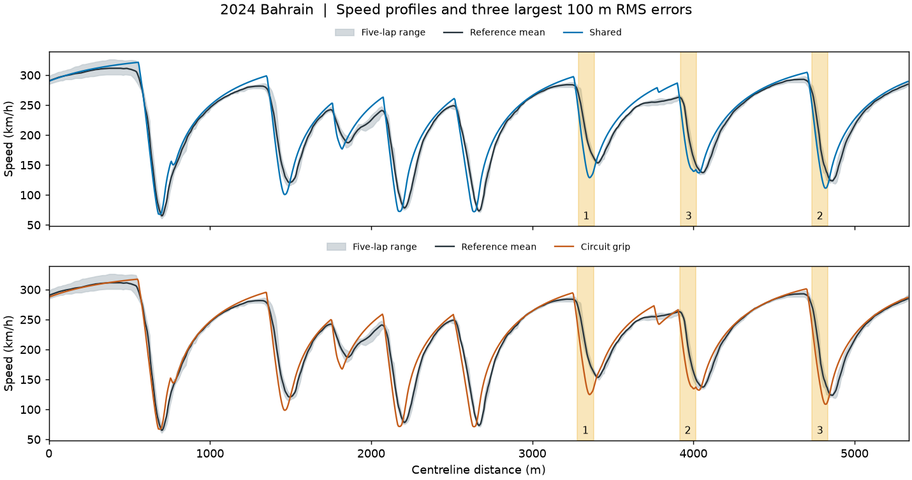
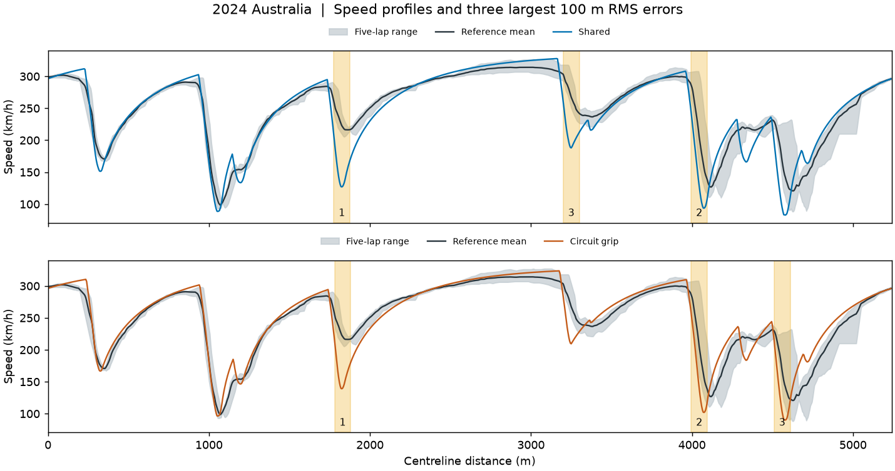
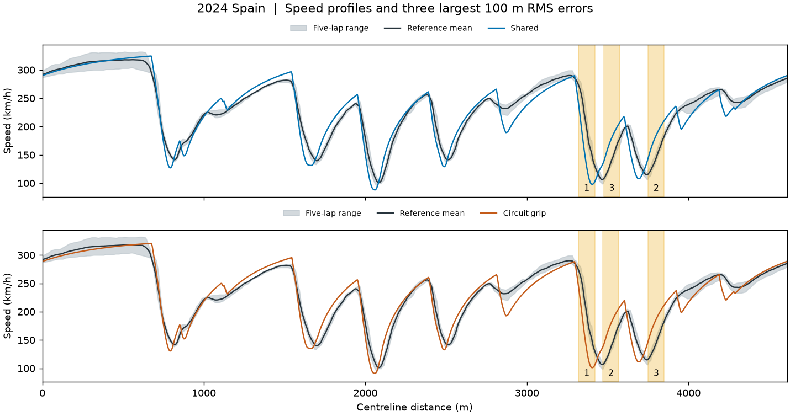
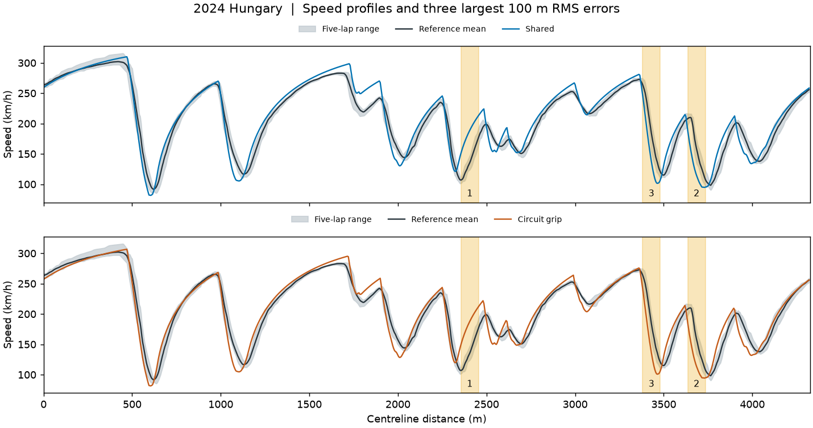
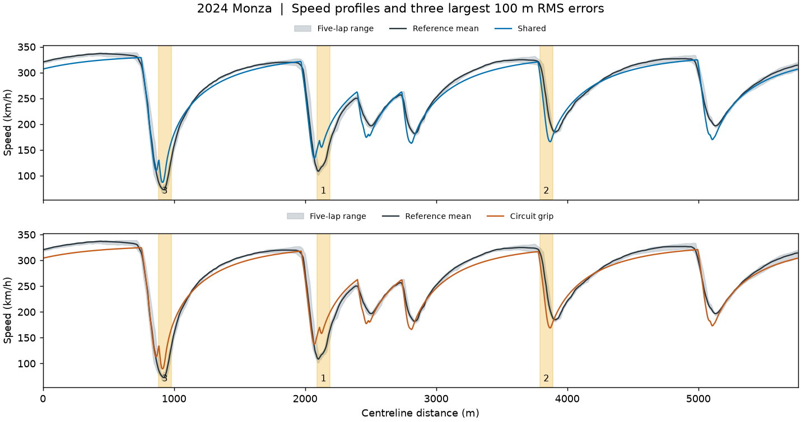

# 五站单圈标定与燃油效应（2024）

逐站抓地模型的五站圈时均贴近参考圈时，但逐点车速仍有偏差。正式标定的两个模型都把有效轮上功率推到 450 kW 下界。以下为样本内描述和给定参数下的质量敏感性。

## 方法

使用 T048 五个分站、每站五个绿旗非进出站快圈。保留原始 5 m 网格、有符号曲率、相位和闭合末段。拟合对象为五圈车速均值，圈时目标为五个实测圈时的算术均值。每场质量固定为 798 kg 加估计平均余油：假定 107.5 kg 均匀耗尽，第 l 圈中点的余油为 107.5 × [1 − (l − 0.5)/正赛圈数] kg，再对五个样本圈取平均。其余固定量沿用 T049（空气密度 1.20 kg/m³，前轴静态与气动份额均为 0.46，独立限速 110 m/s）。

逐站目标 J = Σᵢ wᵢ[(模拟速度−参考速度)/10 km/h]² + [(模拟圈时−参考圈时)/2 s]²，各站等权相加。wᵢ 正比于 1/[10² + ((最高−最低参考速度)/2)²]，站内归一至 1，速度用 km/h。权重让五圈分散的区段影响较小，10 km/h 和 2 s 为选定的拟合尺度。优化为 scipy 有界非线性最小二乘，两个确定性起点取较低损失；逐站版只放开 μ，功率、两项面积和制动上限仍跨站共用。每个目标均用全圈 T049 求解。后验未参与标定。

## 最终参数与拟合误差

| 模型 | P (kW) | CdA (m²) | ClA (m²) | 制动 (m/s²) | μ | J |
| --- | --- | --- | --- | --- | --- | --- |
| 共用 | 450.000 | 0.933 | 5.475 | 38.457 | 1.5917 | 15.252 |
| 逐站 μ | 450.000 | 0.981 | 4.929 | 36.479 | 见逐站表 | 10.619 |

所有误差取模拟减参考；速度 RMSE 按距离等权计算，最高与最低为两条曲线各自全圈极值之差（km/h）。

| 站 | 模型 | 质量 kg | μ | 参考 s | 模拟 s | Δ圈时 s | 速度 RMSE | Δ最高速 | Δ最低弯速 |
| --- | --- | --- | --- | --- | --- | --- | --- | --- | --- |
| 巴林 | 共用 | 831.8 | 1.5917 | 93.947 | 91.974 | -1.974 | 17.849 | 9.907 | 2.508 |
| 澳大利亚 | 共用 | 810.0 | 1.5917 | 80.048 | 82.990 | 2.941 | 23.040 | 13.518 | -15.593 |
| 西班牙 | 共用 | 822.3 | 1.5917 | 77.672 | 78.326 | 0.654 | 19.106 | 6.480 | -13.182 |
| 匈牙利 | 共用 | 822.4 | 1.5917 | 80.862 | 79.707 | -1.155 | 18.115 | 8.067 | -10.019 |
| 蒙扎 | 共用 | 804.7 | 1.5917 | 81.734 | 81.551 | -0.183 | 13.708 | -7.838 | 14.160 |
| 巴林 | 逐站 μ | 831.8 | 1.5777 | 93.947 | 93.769 | -0.179 | 17.891 | 5.831 | 1.700 |
| 澳大利亚 | 逐站 μ | 810.0 | 1.8593 | 80.048 | 80.037 | -0.011 | 19.961 | 9.385 | -8.387 |
| 西班牙 | 逐站 μ | 822.3 | 1.7088 | 77.672 | 77.546 | -0.125 | 18.491 | 2.600 | -10.369 |
| 匈牙利 | 逐站 μ | 822.4 | 1.6160 | 80.862 | 80.852 | -0.011 | 17.351 | 4.698 | -10.127 |
| 蒙扎 | 逐站 μ | 804.7 | 1.7038 | 81.734 | 81.511 | -0.223 | 14.648 | -12.372 | 16.779 |

共用：五站等权平均 |圈时误差| 1.381 s，平均速度 RMSE 18.36 km/h。

逐站 μ：五站等权平均 |圈时误差| 0.110 s，平均速度 RMSE 17.67 km/h。

## 参数合理性和可辨识性

任务单给出的比较量级为功率 750–800 kW、CdA 0.9–1.3 m²、ClA 4–6 m²、μ 1.5–2。两模型面积和 μ 落入这些范围，有效功率明显偏低。2024 年无油质量基准为 798 kg；车队公开资料列出的 MGU-K 峰值 120 kW 只描述动力单元中的电机部分。这里的恒定轮上功率还会吸收收油、混动释放、传动损失与赛车线误差，不能作为发动机台架测量值。制动参数为机械减速度上限，另有抓地和气阻约束。[FIA 质量说明](https://www.fia.com/news/formula-1-commission-meeting-23072024-media-statement) · [Mercedes W15 技术规格](https://www.mercedesamgf1.com/f1-w15-2024-technical-specifications)

主拟合搜索范围为 P 450–1050 kW、CdA 0.5–2、ClA 1–9 m²、制动 10–65 m/s²、μ 0.8–2.8。局部线性化的参数相关矩阵保存在 outputs/correlation_shared.csv 和 outputs/correlation_track_mu.csv。按缩放雅可比的正规矩阵伪逆计算；边界处的数值仅说明参数补偿方向。

共用：功率与 CdA 的局部相关 0.951；ClA 与 μ 的相关范围 -0.971 至 -0.971。两个起点的 J 分别为 15.25231、15.25224。

逐站 μ：功率与 CdA 的局部相关 0.945；ClA 与 μ 的相关范围 -0.963 至 -0.878。两个起点的 J 分别为 10.61915、10.61915。

固定功率并重新优化其余参数。350 kW 探查主拟合下界之外，775 kW 对应任务单给的参考量级。表中 J 是加权损失，未作似然标度。

| 模型 | 固定功率 kW | 重新拟合 J | CdA m² | 五站物理中点范围 s/圈 |
| --- | --- | --- | --- | --- |
| 共用 | 350 | 13.795 | 0.560 | 0.0445–0.0560 |
| 共用 | 450 | 15.252 | 0.933 | 0.0441–0.0521 |
| 共用 | 775 | 26.024 | 2.000 | 0.0437–0.0471 |
| 逐站 μ | 350 | 9.515 | 0.596 | 0.0395–0.0514 |
| 逐站 μ | 450 | 10.619 | 0.981 | 0.0408–0.0490 |
| 逐站 μ | 775 | 20.407 | 2.000 | 0.0353–0.0409 |

把功率固定到 350 kW 时，两种拟合的损失都继续下降，但对应 CdA 下降到约 0.56–0.60 m²，低于任务参考量级。固定到 775 kW 时，两者 CdA 均触及搜索上界 2.0 m²，损失明显上升。速度与圈时数据在这套模型中无法同时支持参考功率和合理阻力；450 kW 是有界解，不能解释为测得的轮上功率。

## 燃油对照

v3.1 的 gamma[race] 乘以站内中心化的剩余圈数，因变量是以秒计、减去分站中位数的圈时。故 γ 的单位为秒/多剩一圈，正值表示其他条件相同时，剩余圈数多一圈会更慢。以 model_laps 的 2024 行首次出现的 race_id 顺序重建 factorize 的映射，使用 outputs31_2024 的 gamma 全部 4000 个抽样，区间取 5% 和 95% 分位数。

物理系数 = [t(m+5)−t(m−5)]/10 × 总燃油/正赛圈数，单位为秒/多剩一圈。质量差分保持拟合参数固定。低/中/高取 105/107.5/110 kg；这个范围只传播总油量假设，不包含参数或赛道几何不确定性。中点落入、两区间相交分别按未舍入数值判断。

| 站 | 模型 | ∂t/∂m (s/kg) | 物理中点 [低,高] s/圈 | γ 均值 [5%,95%] s/圈 | 中点落入 | 区间相交 |
| --- | --- | --- | --- | --- | --- | --- |
| 巴林 | 共用 | 0.02763 | 0.0521 [0.0509,0.0533] | 0.0697 [0.0658,0.0738] | 否 | 否 |
| 澳大利亚 | 共用 | 0.02696 | 0.0500 [0.0488,0.0511] | 0.0545 [0.0501,0.0590] | 否 | 是 |
| 西班牙 | 共用 | 0.03078 | 0.0501 [0.0490,0.0513] | 0.0618 [0.0581,0.0656] | 否 | 否 |
| 匈牙利 | 共用 | 0.02874 | 0.0441 [0.0431,0.0452] | 0.0483 [0.0453,0.0513] | 否 | 否 |
| 蒙扎 | 共用 | 0.02480 | 0.0503 [0.0491,0.0515] | 0.0612 [0.0565,0.0661] | 否 | 否 |
| 巴林 | 逐站 μ | 0.02600 | 0.0490 [0.0479,0.0502] | 0.0697 [0.0658,0.0738] | 否 | 否 |
| 澳大利亚 | 逐站 μ | 0.02611 | 0.0484 [0.0473,0.0495] | 0.0545 [0.0501,0.0590] | 否 | 否 |
| 西班牙 | 逐站 μ | 0.02869 | 0.0467 [0.0456,0.0478] | 0.0618 [0.0581,0.0656] | 否 | 否 |
| 匈牙利 | 逐站 μ | 0.02656 | 0.0408 [0.0398,0.0417] | 0.0483 [0.0453,0.0513] | 否 | 否 |
| 蒙扎 | 逐站 μ | 0.02325 | 0.0472 [0.0461,0.0483] | 0.0612 [0.0565,0.0661] | 否 | 否 |

共用：五站物理中点与后验均值的 Pearson r = 0.886，Spearman ρ = 0.900；平均物理值减后验均值 -0.0098 s/圈。

逐站 μ：五站物理中点与后验均值的 Pearson r = 0.771，Spearman ρ = 0.600；平均物理值减后验均值 -0.0127 s/圈。

## 速度曲线与局部误差

灰带为五圈参考最小至最大值。两幅子图分别按各自模型的局部 RMSE 标出最差的三个互不重叠的 100 m 区间（黄色，1 为最大，可跨起终线）。区间起止与误差见 outputs/regions.csv。

## 这些结果不能说明什么

两种标定给出同方向、同数量级的燃油效应；逐站 μ 使圈时更接近实测，五站物理中点却都低于对应后验 90% 区间。仅在共用模型的澳大利亚站，油耗范围上端与后验区间相交。因此现有标定不足以独立验证各站 γ 的大小。五点相关只是描述，多出的四个抓地参数也会改善样本内圈时。

五圈可能来自不同车手、圈次、胎龄和油量，曲率经过平滑，中心线与真实赛车线、弯道相位都可能不同。质点模型没有坡度、混动部署、轮胎随载荷和温度的变化；车手节油、保胎、赛道演化等随比赛进程变化的因素也可能进入后验 γ。没有实测油量或受控对照，不能将两种估计的差额归因于其中一项。

## 复现

在项目根目录执行 `OPENBLAS_NUM_THREADS=1 OMP_NUM_THREADS=1 .venv/bin/python analysis/lapsim_calibration/calibrate.py`；用 `--out /临时目录/outputs` 重跑，然后对比两份 outputs 和各自上一级的 report.md。运行 `.venv/bin/python analysis/lapsim_calibration/verify.py` 读回并交叉检查。
